# Lecture map

Textbook: Schermerhorn, Bachrach and Wright, *Management*, 5th Canadian edition (2020). Red headings are bullets; blue terms and in-text figure references are sub-bullets.

The map was extracted from the specified textbook chapters by following their two-column reading order, recording red headings as bullets and blue in-text terms and figure references as sub-bullets, then checking the extraction against the PDF.

# Chapter 1 Management Today

## 1.1 Working Today
- Talent
    - intellectual capital
    - Competency
    - Commitment
    - knowledge workers
    - **intellectual capital** is the collective brainpower and knowledge of a workforce. **Competency** is the ability to do a job well. **Commitment** is the willingness to work hard for the organization. **knowledge workers** use their minds and knowledge to create value.
- Technology
    - fourth industrial age
    - Tech IQ
    - The **fourth industrial age** brings together digital technologies that change how people live and work. **Tech IQ** is the ability to understand and use technology effectively.
- Globalization
    - globalization
    - job migration
    - reshoring
    - **globalization** is the worldwide interdependence of resources, markets and competition. **job migration** occurs when jobs move between countries. **reshoring** brings jobs back to the country from which they previously moved.
- Ethics
    - ethics
    - corporate governance
    - **ethics** are moral standards that guide behaviour. **corporate governance** is the system through which a corporation is directed and controlled.
- Diversity
    - workforce diversity
    - prejudice
    - discrimination
    - glass ceiling effect
    - **workforce diversity** refers to differences among the people who work in an organization. **prejudice** is a negative attitude toward someone based on their group membership. **discrimination** occurs when a person is treated unfairly because of such characteristics. The **glass ceiling effect** is an invisible barrier that limits advancement for some groups.
- Careers and Connections
    - shamrock
    - free-agent economy
    - self-management
    - Social networking
    - The **shamrock** describes an organization using different groups of workers, including core, contract and part-time workers. In the **free-agent economy**, people take greater responsibility for managing their own careers. **self-management** means managing yourself and your career through learning and personal responsibility. **Social networking** connects people who can share information, advice and opportunities.

## 1.2 Organizations
- Organizational Purpose
    - organization
    - An **organization** is a group of people working together to achieve a common purpose.
- Organizations as Systems
    - open systems
    - 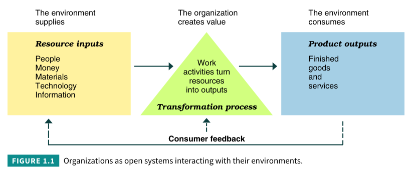
    - **open systems** interact with their environment by obtaining resources, transforming them into outputs and receiving feedback.
- Organizational Performance
    - productivity
    - 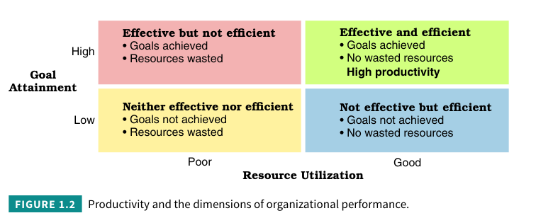
    - Performance effectiveness
    - Performance efficiency
    - **productivity** measures the quantity and quality of outputs compared with the resources used. **Performance effectiveness** is achieving a goal or completing a task. **Performance efficiency** is using resources well while achieving results.
- Changing Nature of Organizations
    - Organizations are changing their structures and work practices to respond to technology, competition and the needs of their employees and customers.

## 1.3 Managers
- What Is a Manager?
    - managers
    - **managers** support and oversee the work of others so that a group or organization can achieve its goals.
- Levels of Managers
    - 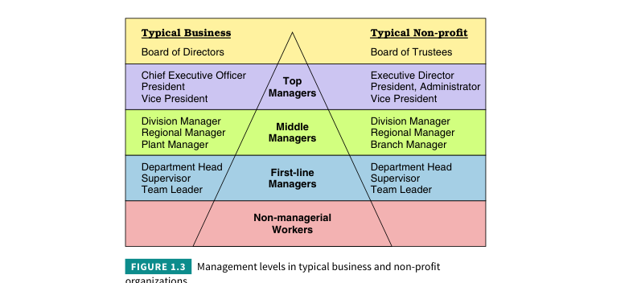
    - board of directors
    - top managers
    - middle managers
    - team leader
    - The **board of directors** oversees the organization and holds its top management accountable. **top managers** are responsible for the performance of the whole organization or a major part of it. **middle managers** report to top managers and oversee the work of other managers. A **team leader** guides and supports the work of a team.
- Types of Managers
    - Line managers
    - Staff managers
    - Functional managers
    - General managers
    - administrators
    - **Line managers** are directly responsible for work that contributes to an organization’s products or services. **Staff managers** lead specialist activities that support line operations. **Functional managers** oversee people with similar skills or responsibilities. **General managers** oversee a range of different functions. **administrators** are managers who work in public or nonprofit organizations.
- Managerial Performance
    - Accountability
    - 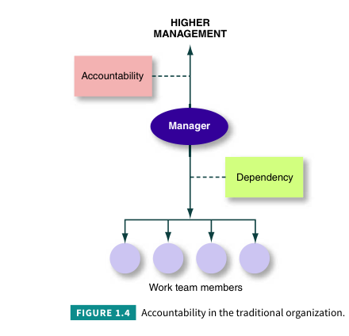
    - effective managers
    - quality of work life
    - **Accountability** means being expected to explain and take responsibility for results. **effective managers** help others achieve high performance and satisfaction in their work. **quality of work life** describes the overall quality of people’s experiences at work.
- Changing Nature of Managerial Work
    - upside-down pyramid
    - 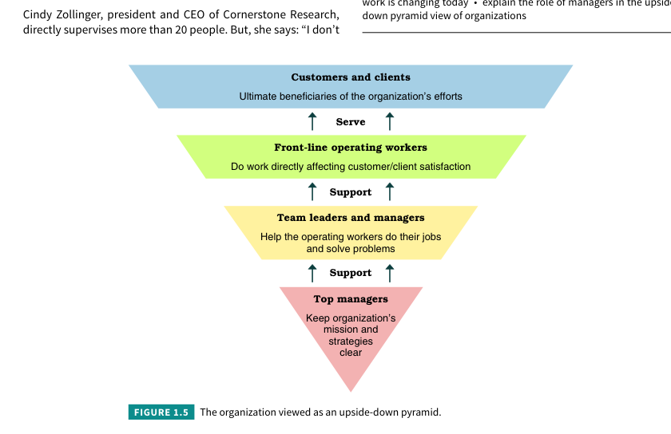
    - The **upside-down pyramid** places customers and the employees who serve them at the top, with managers supporting their work.

## 1.4 The Management Process
- Functions of Management
    - 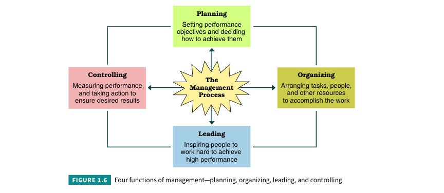
    - Planning
    - organizing
    - Leading
    - controlling
    - **Planning** sets objectives and decides how to achieve them. **organizing** arranges people and resources to carry out the plan. **Leading** inspires and influences people to work toward objectives. **controlling** measures performance and takes action when results differ from objectives.
- Managerial Roles and Activities
    - 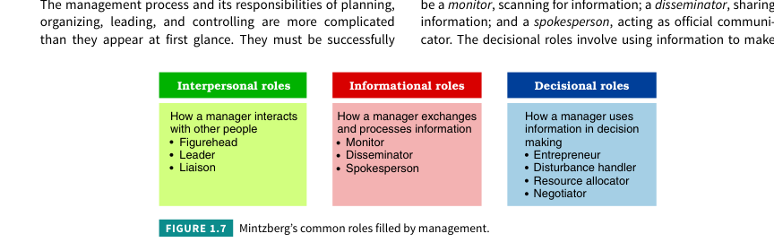
    - Managers perform interpersonal, informational and decision-making roles as they work with people, handle information and address problems.
- Managerial Agendas and Networks
    - agenda setting
    - networking
    - social capital
    - **agenda setting** involves developing priorities for action. **networking** builds relationships with people who can provide information and support. **social capital** is the value of these relationships and the resources they make available.

## 1.5 Learning How to Manage
- Lifelong Learning
    - lifelong learning
    - **lifelong learning** is the continuing process of learning and developing throughout a person’s career.
- Management Skills
    - skill
    - 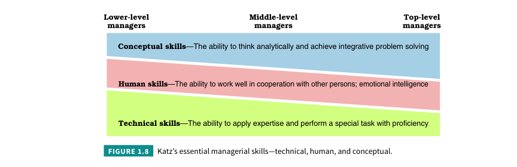
    - A **skill** is an ability to use knowledge effectively in performing a task.
- Technical Skills
    - Technical skills are the ability to apply specialized knowledge and methods to a particular task.
- Human and Interpersonal Skills
    - emotional intelligence
    - **emotional intelligence** is the ability to understand and manage emotions in yourself and in relationships with others.
- Critical-Thinking Skills
    - 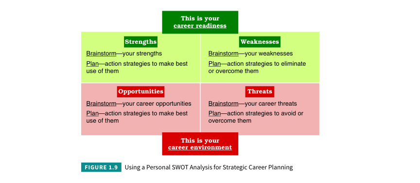
    - Critical-thinking skills help managers analyse information, identify problems and make reasoned decisions.

# Chapter 2 Management Learning Past to Present

## 2.1 Classical Management Approaches
- Scientific Management
    - scientific management
    - motion study
    - **scientific management** uses systematic study to find more efficient ways of doing work. A **motion study** breaks a task into basic physical movements to identify improvements.
- Administrative Principles
    - Administrative principles describe general management practices that help organizations operate effectively.
- Bureaucratic Organization
    - bureaucracy
    - 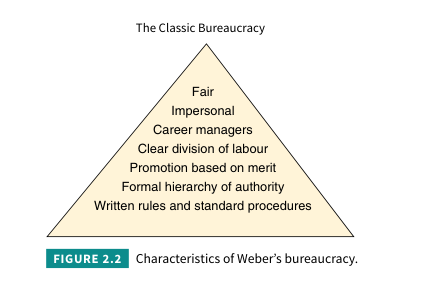
    - **bureaucracy** is an organization based on a clear division of labour, a hierarchy of authority and formal rules.

## 2.2 Behavioural Management Approaches
- Follett’s Organizations as Communities
    - Follett viewed organizations as communities in which managers and workers cooperate and resolve differences constructively.
- The Hawthorne Studies
    - Hawthorne effect
    - The **Hawthorne effect** is the tendency for people to perform differently when they receive special attention and develop expectations about their work.
- Maslow’s Theory of Human Needs
    - need
    - 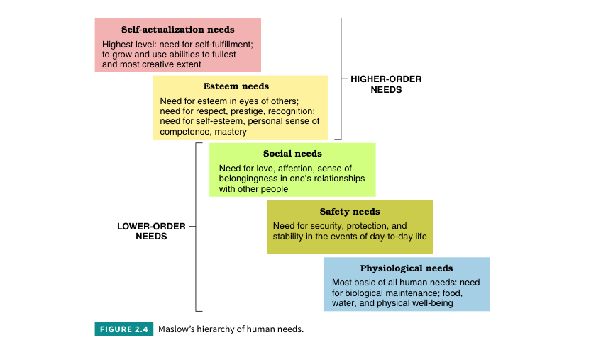
    - deficit principle
    - progression principle
    - A **need** is a physiological or psychological requirement that a person seeks to satisfy. The **deficit principle** says a satisfied need no longer motivates behaviour. The **progression principle** says a higher-level need becomes important as lower-level needs are satisfied.
- McGregor’s Theory X and Theory Y
    - Theory X
    - Theory Y
    - self-fulfilling prophecies
    - **Theory X** assumes that people dislike work and need close direction and control. **Theory Y** assumes that people can enjoy work and exercise self-direction when committed to objectives. **self-fulfilling prophecies** occur when managers’ assumptions influence their behaviour in ways that encourage employees to confirm those assumptions.
- Argyris’s Theory of Adult Personality
    - Argyris argued that strict organizations can prevent adults from developing independence and using their abilities fully.

## 2.3 Modern Management Foundations
- Quantitative Analysis and Tools
    - analytics
    - **analytics** is the systematic analysis of data to solve problems and support informed decisions.
- Organizations as Systems
    - system
    - subsystems
    - open systems
    - 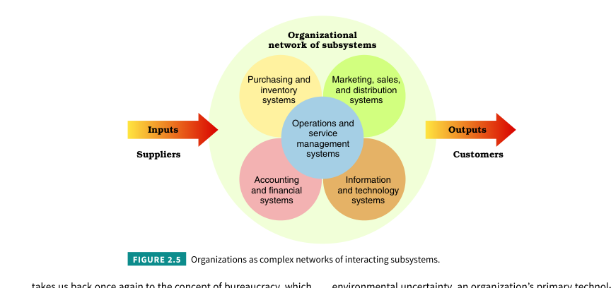
    - A **system** is a collection of connected parts working together for a purpose. **subsystems** are smaller parts of a larger system. **open systems** interact with their environment by exchanging resources and information.
- Contingency Thinking
    - contingency thinking
    - learning style
    - **contingency thinking** holds that the best management approach depends on the situation. A **learning style** is a preferred way of gathering and processing information when learning.
- Quality Management
    - total quality management
    - continuous improvement
    - ISO certification
    - **total quality management** makes quality a central concern throughout an organization. **continuous improvement** involves ongoing efforts to improve work processes and results. **ISO certification** recognizes that an organization has met specified quality management standards through an independent assessment.
- Evidence-Based Management
    - evidence-based management
    - **evidence-based management** uses the best available evidence to inform management decisions.

# Chapter 3 Ethics and Social Responsibility

## 3.1 Ethics
- Laws and Values as Influences on Ethical Behaviour
    - values
    - Terminal values
    - Instrumental values
    - **values** are beliefs about what is important and desirable. **Terminal values** concern desired outcomes or end states. **Instrumental values** concern preferred ways of behaving.
- Alternative Views of Ethics
    - 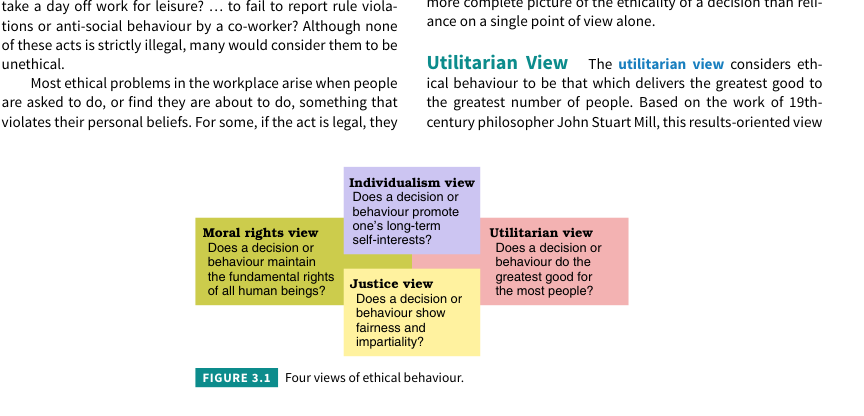
    - utilitarian view
    - individualism view
    - moral rights view
    - justice view
    - Procedural justice
    - Distributive justice
    - Interactional justice
    - Commutative justice
    - The **utilitarian view** judges actions by their consequences for the greatest number. The **individualism view** favours actions that advance long-term individual interests. The **moral rights view** assesses actions by whether they respect fundamental rights. The **justice view** asks whether people are treated fairly. **Procedural justice** concerns the fairness of decision processes. **Distributive justice** concerns the fairness of outcomes. **Interactional justice** concerns respectful and fair interpersonal treatment. **Commutative justice** concerns fairness in exchanges and transactions.
- Cultural Issues in Ethical Behaviour
    - cultural relativism
    - 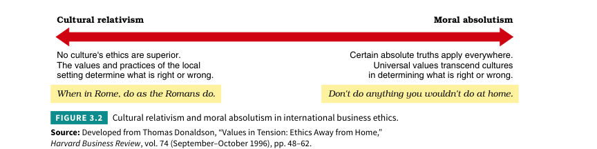
    - moral absolutism
    - ethical imperialism
    - **cultural relativism** judges behaviour according to the values of the local culture. **moral absolutism** applies the same moral standards across situations and cultures. **ethical imperialism** imposes one culture’s ethical standards on people in another culture.

## 3.2 Ethics in the Workplace
- Ethical Dilemmas
    - ethical dilemma
    - 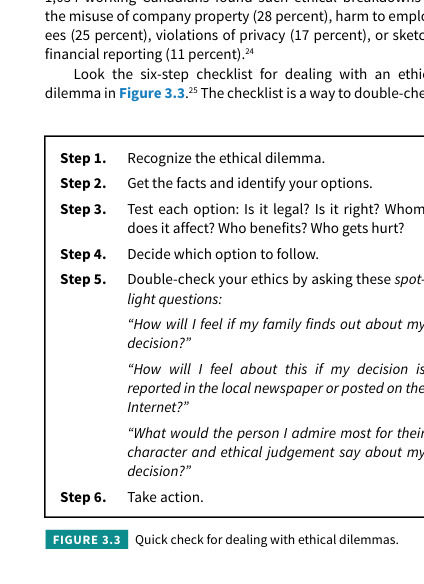
    - An **ethical dilemma** is a situation in which a person must choose between alternatives that have ethical consequences.
- Influences on Ethical Decision-Making
    - ethical framework
    - 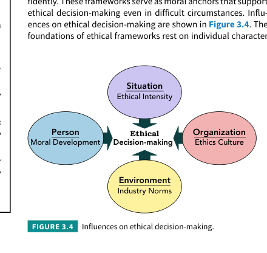
    - 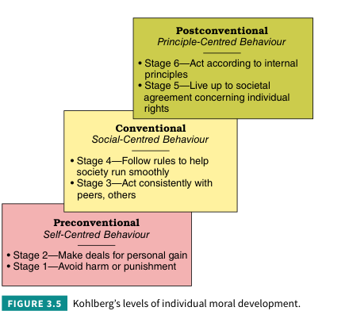
    - ethics intensity
    - issue intensity
    - An **ethical framework** provides principles for judging and guiding decisions. **ethics intensity** is the extent to which a situation is perceived as an important ethical challenge. **issue intensity** is another term for the perceived ethical importance of the issue.
- Rationalizations for Unethical Behaviour
    - People may rationalize unethical behaviour by claiming it is acceptable, helps the organization, will not be discovered or will be protected by others.

## 3.3 Maintaining High Ethical Standards
- Moral Management
    - 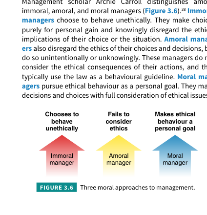
    - Immoral managers
    - Amoral managers
    - Moral managers
    - **Immoral managers** knowingly act against ethical principles. **Amoral managers** do not give ethical implications sufficient consideration. **Moral managers** deliberately apply ethical principles in their decisions.
- Ethics Training
    - Ethics training
    - **Ethics training** helps people recognize ethical issues and respond to them in their work.
- Codes of Ethical Conduct
    - codes of ethics
    - **codes of ethics** state the values and standards that should guide conduct in an organization.
- Whistleblower Protection
    - whistleblower
    - A **whistleblower** reports unethical or illegal conduct by an organization or its members.

## 3.4 Social Responsibility
- Stakeholder Management
    - Stakeholder power
    - Demand legitimacy
    - Issue urgency
    - **Stakeholder power** is a stakeholder’s ability to influence the organization. **Demand legitimacy** concerns whether a stakeholder’s claim is viewed as appropriate. **Issue urgency** concerns how pressing a stakeholder’s claim is.
- Social Responsibility, Sustainability, and the Triple Bottom Line
    - corporate social responsibility
    - stewardship
    - Sustainability
    - triple bottom line
    - 3 Ps of organizational performance
    - **corporate social responsibility** is an organization’s obligation to consider the interests of its stakeholders and society. **stewardship** means taking responsibility for protecting stakeholder interests. **Sustainability** means meeting present needs while supporting the well-being of future generations. The **triple bottom line** assesses social and environmental results as well as financial results. The **3 Ps of organizational performance** are people, planet and profit.
- Perspectives on Corporate Social Responsibility
    - classical view of CSR
    - socio-economic view of CSR
    - shared value view of CSR
    - virtuous circle
    - The **classical view of CSR** emphasizes maximizing profits within the law. The **socio-economic view of CSR** argues that businesses also have responsibilities to society. The **shared value view of CSR** connects business success with social progress. A **virtuous circle** can occur when social investment improves financial performance and enables further social investment.
- Evaluating Corporate Social Performance
    - social responsibility audits
    - 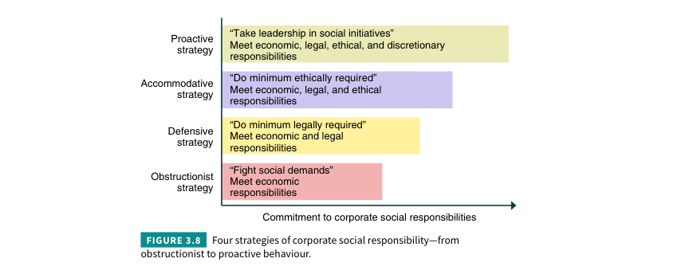
    - obstructionist strategy
    - defensive strategy
    - accommodative strategy
    - proactive strategy
    - **social responsibility audits** assess an organization’s social performance. An **obstructionist strategy** resists social responsibility. A **defensive strategy** does the minimum required by law. An **accommodative strategy** accepts social responsibilities and responds to expectations. A **proactive strategy** anticipates social concerns and acts on them.
- Corporate Governance
    - Corporate governance
    - Sarbanes-Oxley Act of 2002
    - 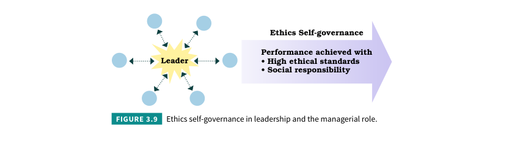
    - ethics self-governance
    - **Corporate governance** is the oversight of management by a board of directors. The **Sarbanes-Oxley Act of 2002** introduced US requirements intended to improve corporate oversight and financial reporting. **ethics self-governance** involves organizations taking responsibility for monitoring and improving their own ethical conduct.

# Chapter 8 Planning Processes and Techniques

## 8.1 Why and How Managers Plan
- Importance of Planning
    - 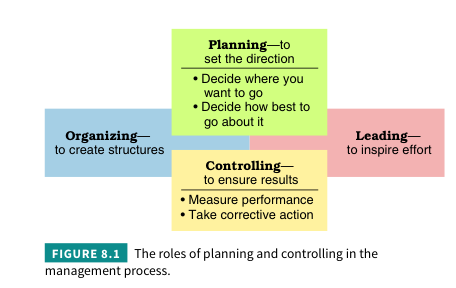
    - Planning sets a direction and helps managers decide how to use resources to achieve desired results.
- The Planning Process
    - objectives
    - goals
    - stretch goals
    - plan
    - **objectives** are specific results that people or organizations aim to achieve. **goals** are desired future results. **stretch goals** are especially challenging targets that call for exceptional effort. A **plan** sets out the actions needed to reach an objective.
- Benefits of Planning
    - complacency trap
    - The **complacency trap** occurs when success leads people to assume that current practices will always work.
- Planning and Time Management
    - Planning and prioritizing tasks help managers use their time effectively and focus on important work.

## 8.2 Types of Plans Used by Managers
- Long-Term and Short-Term Plans
    - long-term plans
    - short-term plans
    - 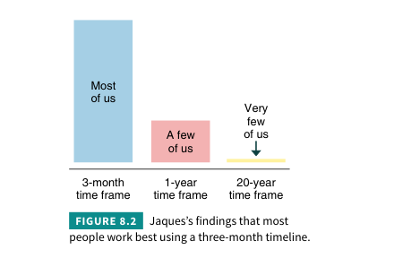
    - **long-term plans** look several years into the future. **short-term plans** cover a shorter period and guide more immediate actions.
- Strategic and Tactical Plans
    - Strategic plans
    - vision
    - Tactical plans
    - functional plans
    - **Strategic plans** set broad directions and objectives for an organization. A **vision** describes a desired future for the organization. **Tactical plans** support strategic plans through more specific actions. **functional plans** describe actions within particular areas such as marketing or finance.
- Operational Plans
    - Operational plans
    - policy
    - Procedures
    - Budgets
    - zero-based budget
    - **Operational plans** guide day-to-day activities. A **policy** provides general guidance for making decisions. **Procedures** set out steps for handling recurring situations. **Budgets** allocate resources to activities over a period. A **zero-based budget** requires proposed spending to be justified from the beginning of each budgeting period.

## 8.3 Planning Tools and Techniques
- Forecasting
    - forecasting
    - **forecasting** uses information and analysis to estimate future conditions.
- Contingency Planning
    - contingency planning
    - **contingency planning** prepares alternative actions for events that may occur.
- Scenario Planning
    - Scenario planning
    - **Scenario planning** considers several possible future situations and their implications for decisions.
- Benchmarking
    - benchmarking
    - best practices
    - **benchmarking** compares practices and performance with those of other organizations. **best practices** are approaches identified as particularly effective.
- Staff Planning
    - Staff planners support managers by gathering information and assisting with planning activities.

## 8.4 Implementing Plans to Achieve Results
- Goal Setting
    - 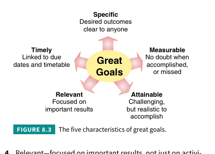
    - Goal setting gives people a clear target and can direct attention and effort toward desired results.
- Goal Management
    - learning goals
    - outcome goals
    - **learning goals** focus on developing knowledge and skills. **outcome goals** focus on achieving a particular result.
- Goal Alignment
    - 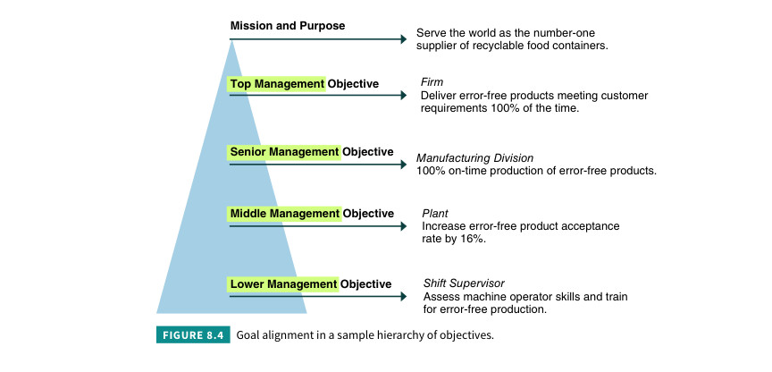
    - hierarchy of goals
    - hierarchy of objectives
    - 
    - 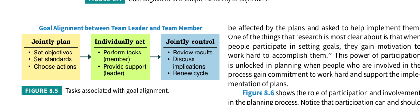
    - A **hierarchy of goals** connects goals at different levels of an organization. A **hierarchy of objectives** links individual and team objectives to broader organizational objectives.
- Participation and Involvement
    - Participatory planning
    - 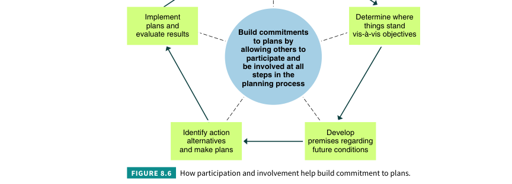
    - **Participatory planning** involves people who will be affected by or responsible for a plan in developing it.
- Resilience
    - Resilience is the ability to adapt and recover when plans face difficulties or unexpected changes.

# Chapter 9 Control Processes and Systems

## 9.1 Why and How Managers Control
- Importance of Controlling
    - controlling
    - 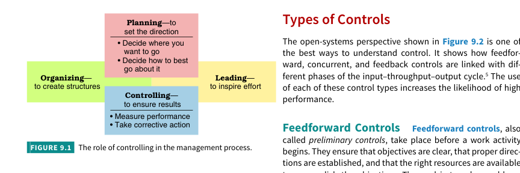
    - after-action review
    - **controlling** measures performance and takes action to support the achievement of objectives. An **after-action review** examines what happened, why it happened and what can be learned.
- Types of Controls
    - 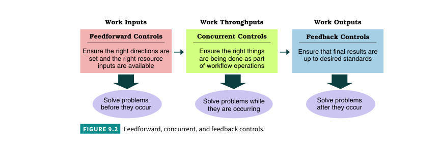
    - Feedforward controls
    - Concurrent controls
    - Feedback controls
    - **Feedforward controls** address potential problems before work begins. **Concurrent controls** monitor and address problems while work is taking place. **Feedback controls** assess results after work is completed.
- Internal and External Control
    - self-control
    - bureaucratic control
    - clan control
    - Strategic control
    - Market control
    - **self-control** relies on people directing their own behaviour. **bureaucratic control** uses rules, policies and formal supervision. **clan control** relies on shared values and expectations. **Strategic control** assesses progress toward strategic objectives. **Market control** uses market information and competition to assess performance.

## 9.2 The Control Process
- Step 1—Establish Objectives and Standards
    - Pareto Principle
    - output standards
    - input standards
    - The **Pareto Principle** suggests that a small number of causes often account for a large share of effects. **output standards** measure results such as quantity, quality or cost. **input standards** measure the resources and efforts used in work.
- Step 2—Measure Actual Performance
    - Managers collect information about actual performance so it can be compared with established standards.
- Step 3—Compare Results with Objectives and Standards
    - control equation
    - The **control equation** compares actual performance with the desired standard to identify any difference.
- Step 4—Take Corrective Action
    - Management by exception
    - **Management by exception** directs attention to significant differences between actual and desired performance.

## 9.3 Control Tools and Techniques
- Project Management and Control
    - projects
    - Project management
    - Gantt chart
    - 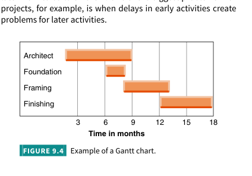
    - CPM/PERT
    - 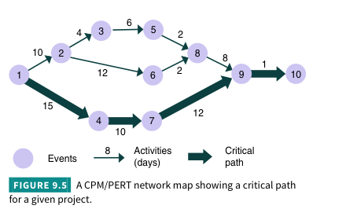
    - critical path
    - **projects** are sets of activities undertaken to achieve a specific result. **Project management** plans, organizes and monitors project activities and resources. A **Gantt chart** displays activities and their planned timing. **CPM/PERT** uses activity networks to plan and monitor projects. The **critical path** is the longest sequence of dependent activities that determines the minimum project duration.
- Inventory Control
    - inventory control
    - economic order quantity
    - 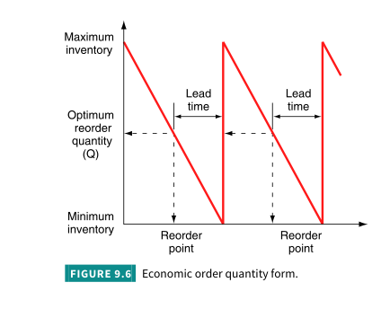
    - just-in-time scheduling (JIT)
    - **inventory control** manages stocks of materials or products to meet needs without excessive cost. The **economic order quantity** is an order size that balances ordering and holding costs. **just-in-time scheduling (JIT)** seeks to obtain or produce items when they are needed.
- Breakeven Analysis
    - breakeven point
    - 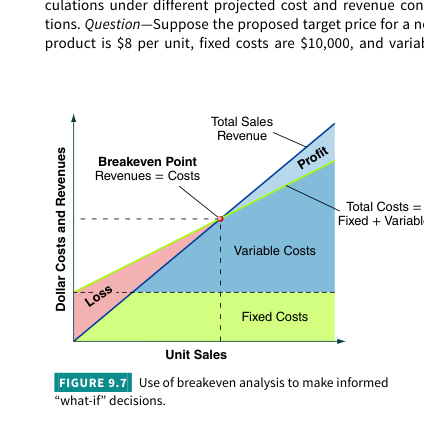
    - breakeven analysis
    - The **breakeven point** is where total revenue equals total costs. **breakeven analysis** examines the relationship between costs, sales volume and profit.
- Financial Controls
    - balance sheet
    - income statement
    - 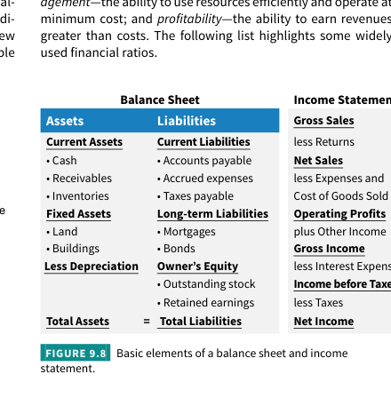
    - A **balance sheet** shows assets, liabilities and owners’ equity at a particular time. An **income statement** reports revenues and expenses over a period.
- Balanced Scorecards
    - balanced scorecard
    - A **balanced scorecard** assesses performance using financial and nonfinancial measures connected to strategy.

# Chapter 10 Strategy and Strategic Management

## 10.1 Strategic Management
- Competitive Advantage
    - competitive advantage
    - sustainable competitive advantage
    - A **competitive advantage** is a strength that helps an organization outperform rivals. A **sustainable competitive advantage** is an advantage that competitors find difficult to copy or overcome over time.
- Strategy and Strategic Intent
    - strategy
    - strategic intent
    - A **strategy** is a plan that sets long-term direction and guides the use of resources. **strategic intent** is a focused commitment to achieving an ambitious strategic goal.
- Levels of Strategy
    - 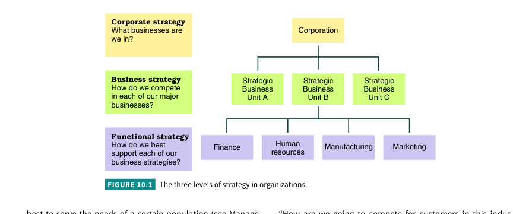
    - corporate strategy
    - Business strategy
    - Functional strategy
    - **corporate strategy** determines the businesses and activities in which an organization will compete. **Business strategy** determines how a business will compete in its chosen market. **Functional strategy** supports business strategy within a particular functional area.
- Strategic Management Process
    - strategic management
    - 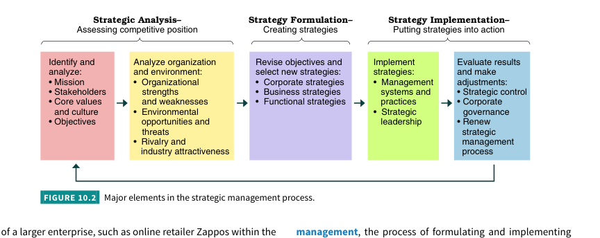
    - strategic analysis
    - strategy formulation
    - strategy implementation
    - **strategic management** is the process of developing and implementing strategies. **strategic analysis** examines the organization and its environment. **strategy formulation** develops and selects a strategy. **strategy implementation** puts the chosen strategy into action.

## 10.2 Essentials of Strategic Analysis
- Analysis of Mission, Values, and Objectives
    - mission
    - stakeholders
    - 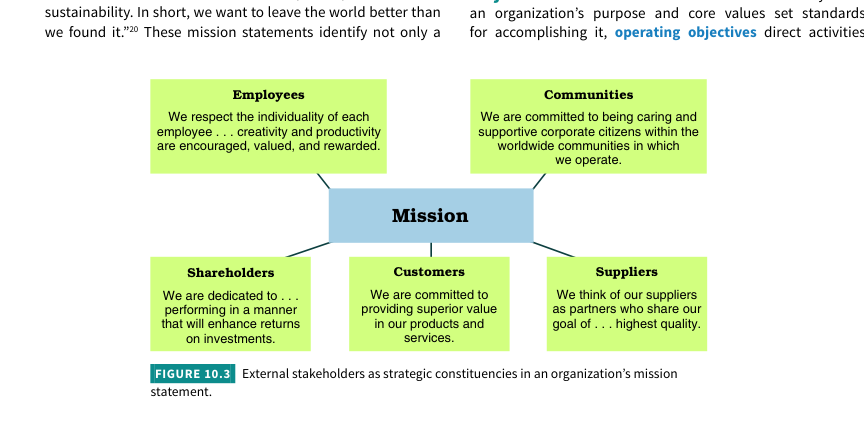
    - Core values
    - organizational culture
    - operating objectives
    - A **mission** states an organization’s purpose. **stakeholders** are people or groups affected by or able to influence the organization. **Core values** are fundamental beliefs that guide decisions and behaviour. **organizational culture** consists of shared beliefs and values that influence behaviour. **operating objectives** identify specific results the organization seeks.
- SWOT Analysis of Organization and Environment
    - SWOT analysis
    - 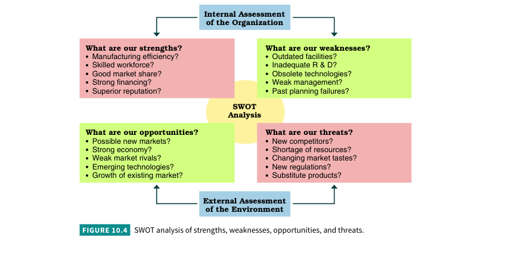
    - core competencies
    - **SWOT analysis** assesses strengths, weaknesses, opportunities and threats. **core competencies** are capabilities that an organization performs especially well and can use to create advantage.
- Five Forces Analysis of Industry Attractiveness
    - 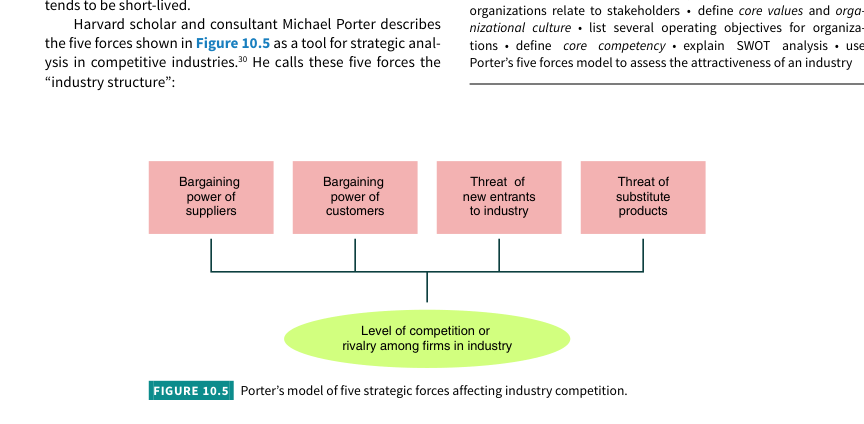
    - Five forces analysis examines industry competition, potential entrants, substitutes, supplier power and buyer power.

## 10.3 Corporate-Level Strategy Formulation
- Portfolio Planning Model
    - BCG Matrix
    - 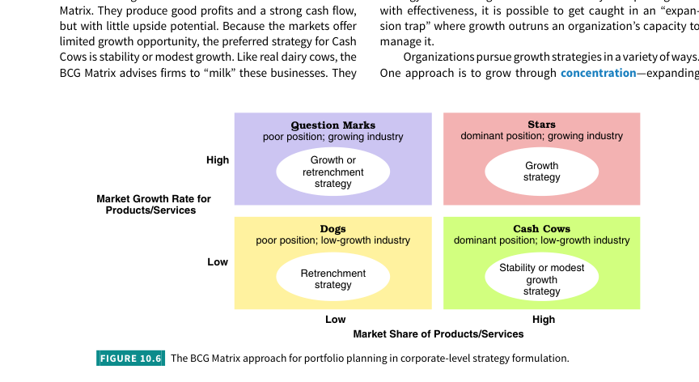
    - The **BCG Matrix** classifies business units by market growth and relative market share to support portfolio decisions.
- Growth and Diversification Strategies
    - growth strategies
    - concentration
    - diversification
    - vertical integration
    - **growth strategies** seek to expand an organization’s operations. **concentration** focuses growth on existing businesses or markets. **diversification** expands into different businesses or markets. **vertical integration** brings activities at different stages of a supply chain under the organization’s control.
- Retrenchment and Restructuring Strategies
    - retrenchment, restructuring, and turnaround strategies
    - Bankruptcy and Insolvency Act
    - liquidation
    - downsizing
    - divestiture
    - turnaround strategy
    - **retrenchment, restructuring, and turnaround strategies** seek to address performance problems and restore viability. The **Bankruptcy and Insolvency Act** provides a legal framework for dealing with insolvency in Canada. **liquidation** sells assets and closes operations. **downsizing** reduces the size of the workforce or operations. **divestiture** sells or disposes of part of a business. A **turnaround strategy** aims to recover from poor performance.
- Global Strategies
    - globalization strategy
    - multidomestic strategy
    - transnational strategy
    - A **globalization strategy** offers relatively standardized products and approaches across countries. A **multidomestic strategy** adapts products and operations to local markets. A **transnational strategy** seeks both global efficiency and local responsiveness.
- Cooperative Strategies
    - strategic alliances
    - co-opetition
    - **strategic alliances** are cooperative arrangements between organizations to pursue shared objectives. **co-opetition** occurs when organizations cooperate in some activities while competing in others.

## 10.4 Business-Level Strategy Formulation
- Competitive Strategies Model
    - 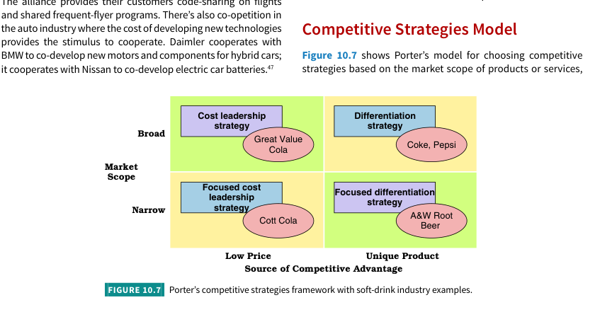
    - The competitive strategies model compares approaches based on cost, differentiation and the scope of the target market.
- Differentiation Strategy
    - differentiation strategy
    - A **differentiation strategy** seeks advantage by offering features that customers value as distinctive.
- Cost Leadership Strategy
    - cost leadership strategy
    - A **cost leadership strategy** seeks advantage by producing at a lower cost than competitors.
- Focus Strategy
    - focus strategy
    - focused differentiation strategy
    - focused cost leadership
    - 
    - A **focus strategy** concentrates on a particular market segment. A **focused differentiation strategy** offers distinctive value to a narrow segment. **focused cost leadership** seeks low costs within a narrow segment.

## 10.5 Strategy Implementation
- Management Practices and Systems
    - lack-of-participation error
    - The **lack-of-participation error** occurs when people responsible for implementation are excluded from developing the strategy.
- Strategic Control and Corporate Governance
    - strategic control
    - corporate governance
    - **strategic control** monitors strategic implementation and results and supports corrective action. **corporate governance** provides oversight of organizational leadership and decisions.
- Strategic Leadership
    - strategic leadership
    - **strategic leadership** guides an organization’s direction and helps people implement its strategy.

# Chapter 11 Organization Structures

## 11.1 Organizing as a Management Function
- What Is Organization Structure?
    - organization structure
    - **organization structure** is the arrangement of tasks, reporting relationships and communication within an organization.
- Formal Structures
    - organization chart
    - formal structure
    - An **organization chart** shows formal positions and reporting relationships. **formal structure** is the official arrangement of jobs and authority.
- Informal Structures and Social Networks
    - informal structure
    - 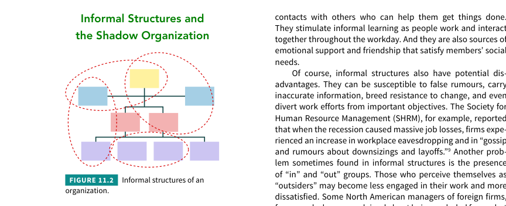
    - social network analysis
    - sociometrics
    - **informal structure** consists of unofficial relationships and communication among people. **social network analysis** examines patterns of relationships among people. **sociometrics** uses techniques to map and analyse those relationships.

## 11.2 Traditional Organization Structures
- Functional Structures
    - functional structures
    - 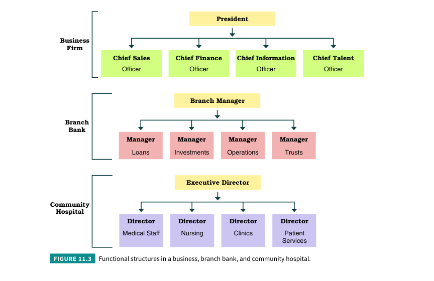
    - functional chimneys
    - functional silos problem
    - 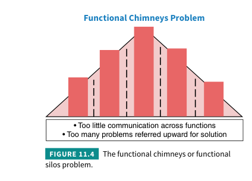
    - Functional Chimneys Problem
    - **functional structures** group people by similar skills or work activities. **functional chimneys** are separate functional areas that may become isolated. The **functional silos problem** arises when departments focus on their own goals and fail to coordinate. The **Functional Chimneys Problem** describes the same difficulty in coordinating across functional boundaries.
- Divisional Structures
    - divisional structure
    - 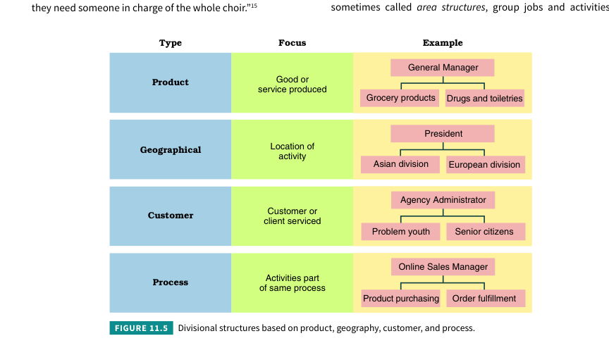
    - Product structures
    - Geographical structures
    - Customer structures
    - work process
    - process structure
    - A **divisional structure** groups activities around a product, location, customer or process. **Product structures** organize divisions around products or services. **Geographical structures** organize divisions around locations. **Customer structures** organize divisions around customer groups. A **work process** is a set of activities that produces a result. A **process structure** organizes work around such processes.
- Matrix Structures
    - matrix structure
    - 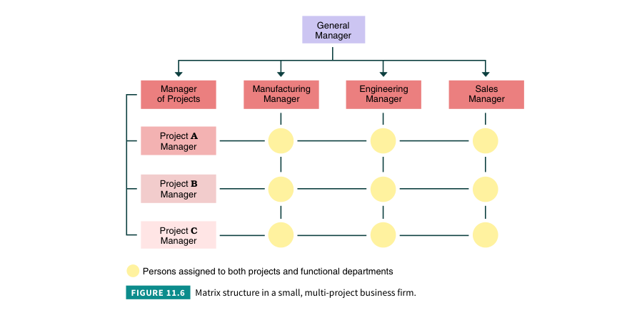
    - A **matrix structure** combines functional and divisional or project reporting relationships.

## 11.3 Team and Network Organization Structures
- Team Structures
    - team structures
    - 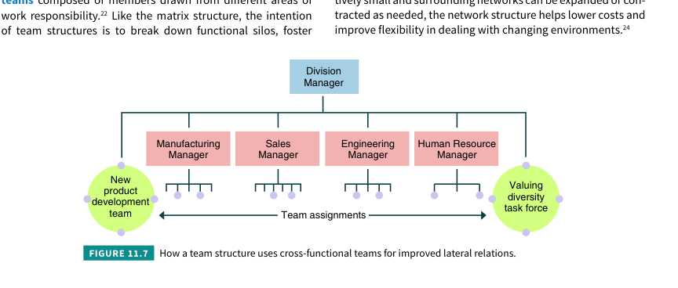
    - cross-functional teams
    - project teams
    - **team structures** organize work around teams. **cross-functional teams** bring together people from different functional areas. **project teams** work together on a specific project.
- Network Structures
    - network structure
    - 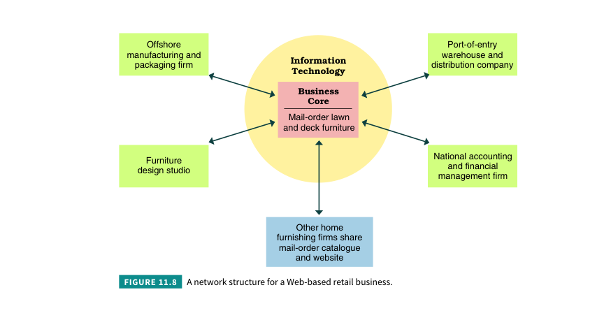
    - strategic alliances
    - A **network structure** links a core organization with outside partners that perform selected activities. **strategic alliances** are cooperative relationships between organizations pursuing shared objectives.
- Boundaryless Structures
    - boundaryless organization
    - 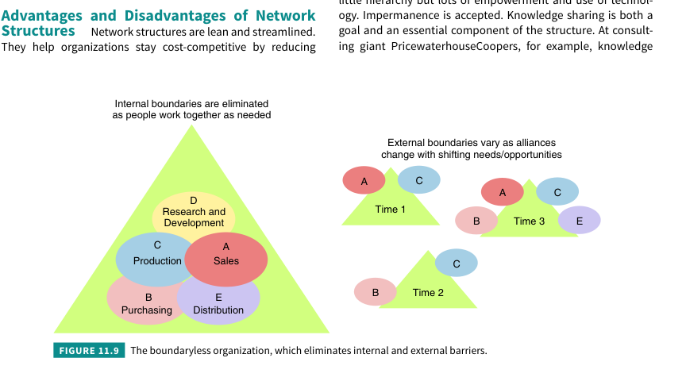
    - virtual organization
    - latent organization
    - A **boundaryless organization** reduces barriers within the organization and between it and outside partners. A **virtual organization** uses technology and partnerships to coordinate work across boundaries. A **latent organization** brings partners together when needed to pursue an opportunity.

## 11.4 Organizational Designs
- Contingency in Organizational Design
    - bureaucracy
    - 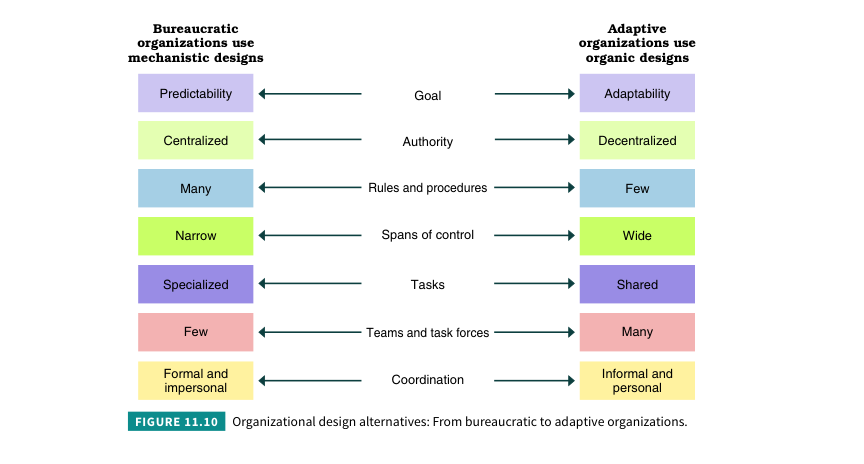
    - **bureaucracy** uses a formal hierarchy, division of labour and rules to coordinate work.
- Mechanistic and Organic Designs
    - mechanistic designs
    - organic designs
    - adaptive organizations
    - **mechanistic designs** emphasize formal rules, hierarchy and centralized decisions. **organic designs** use flexible roles, communication and decentralized decisions. **adaptive organizations** adjust their structures and practices as conditions change.
- Trends in Organizational Designs
    - chain of command
    - span of control
    - tall structures
    - flat structures
    - 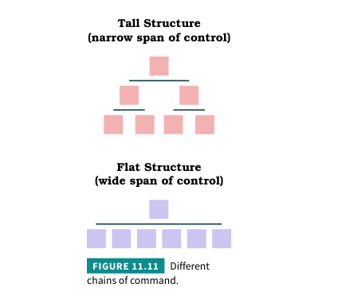
    - delegation
    - self-enhancement bias
    - authority-and-responsibility principle
    - empowerment
    - centralization
    - decentralization
    - staff positions
    - The **chain of command** shows who reports to whom. The **span of control** is the number of people reporting to a manager. **tall structures** have more management levels. **flat structures** have fewer management levels. **delegation** gives another person responsibility and authority for a task. **self-enhancement bias** is the tendency to view one’s own abilities or contributions favourably. The **authority-and-responsibility principle** requires authority to match assigned responsibilities. **empowerment** gives people greater ability and discretion to act. **centralization** concentrates decision authority at higher levels. **decentralization** distributes decision authority to lower levels. **staff positions** provide specialist advice and support.

# Chapter 12 Organization Culture and Change

## 12.1 Organizational Cultures
- Understanding Organizational Cultures
    - 
    - strong organizational cultures
    - socialization
    - **strong organizational cultures** have widely shared values that strongly influence behaviour. **socialization** is the process through which people learn the culture of an organization.
- Observable Culture of Organizations
    - 
    - observable culture
    - **observable culture** consists of visible signs of culture such as stories, ceremonies, dress and workplace arrangements.
- Values and the Core Culture of Organizations
    - core culture
    - core values
    - value-based management
    - symbolic leader
    - workplace spirituality
    - **core culture** consists of the underlying values and beliefs of an organization. **core values** are central beliefs about what matters. **value-based management** uses shared values to guide decisions and conduct. A **symbolic leader** communicates values through words and actions. **workplace spirituality** involves finding meaning, purpose and connection in work.

## 12.2 Multicultural Organizations and Diversity
- Multicultural Organizations
    - multiculturalism
    - multicultural organization
    - **multiculturalism** recognizes and respects cultural differences. A **multicultural organization** includes and values people from different backgrounds.
- Organizational Subcultures
    - organizational subcultures
    - co-cultures
    - ethnocentrism
    - generational subcultures
    - Gender subcultures
    - double-bind dilemma
    - occupational and functional subcultures
    - Ethnic subcultures
    - national subcultures
    - **organizational subcultures** are groups within an organization that share distinct values or experiences. **co-cultures** exist alongside the wider organizational culture. **ethnocentrism** is the belief that one’s own group or culture is superior. **generational subcultures** reflect experiences shared by people of a similar generation. **Gender subcultures** reflect experiences associated with gender. A **double-bind dilemma** occurs when a person faces conflicting expectations and risks criticism whichever way they act. **occupational and functional subcultures** develop among people who share work or professional backgrounds. **Ethnic subcultures** reflect shared ethnic backgrounds and experiences. **national subcultures** reflect shared national backgrounds and experiences.
- Power, Diversity, and Organizational Subcultures
    - 
    - glass ceiling
    - leaking pipeline problem
    - 
    - managing diversity
    - The **glass ceiling** is an invisible barrier to advancement for some groups. The **leaking pipeline problem** describes the loss of potential candidates from a career pathway before they reach senior positions. **managing diversity** involves creating conditions in which people with different backgrounds can contribute and succeed.

## 12.3 Organizational Change
- Models of Change Leadership
    - change leader
    - 
    - Top-down change
    - Bottom-up change
    - A **change leader** guides and supports change in an organization. **Top-down change** is initiated by senior management. **Bottom-up change** starts with people closer to the work and moves upward.
- Transformational and Incremental Change
    - 
    - Transformational change
    - Incremental change
    - 
    - **Transformational change** produces a major change in an organization’s direction or practices. **Incremental change** makes smaller adjustments over time.
- Phases of Planned Change
    - Unfreezing
    - 
    - changing
    - refreezing
    - improvisational change
    - **Unfreezing** prepares people to recognize the need for change. **changing** introduces new behaviours or practices. **refreezing** supports and reinforces the new practices. **improvisational change** develops through ongoing adjustments as people respond to events.
- Change Strategies
    - 
    - force-coercion strategy
    - rational persuasion strategy
    - shared power strategy
    - A **force-coercion strategy** uses authority, rewards or penalties to bring about change. A **rational persuasion strategy** uses information and reasoning to convince people to change. A **shared power strategy** involves people in developing and implementing change.
- Developing Change Approaches
    - Nudge Theory
    - **Nudge Theory** uses the design of choices to encourage a behaviour without removing alternatives.
- Resistance to Change
    - Resistance to change can arise from uncertainty, perceived losses or disagreement, and managers can address it through communication and involvement.

# Chapter 14 Leading and Leadership Development

## 14.1 The Nature of Leadership
- Leadership and Power
    - Power
    - 
    - 
    - reward power
    - Coercive power
    - Legitimate power
    - Expert power
    - human capital
    - Information and networking power
    - social capital
    - Referent power
    - **Power** is the ability to influence another person’s behaviour. **reward power** comes from the ability to provide valued rewards. **Coercive power** comes from the ability to impose penalties. **Legitimate power** comes from a formal position of authority. **Expert power** comes from valued knowledge or skills. **human capital** is the knowledge and skills a person brings to work. **Information and networking power** comes from access to useful information and relationships. **social capital** is the value available through relationships. **Referent power** comes from others’ admiration and identification with a person.
- Leadership and Vision
    - vision
    - visionary leadership
    - A **vision** describes a desired future. **visionary leadership** communicates that future and inspires people to work toward it.
- Leadership and Service
    - servant leadership
    - empowerment
    - **servant leadership** places emphasis on serving and supporting others. **empowerment** gives people the authority and confidence to act.
- Leadership and Followership
    - followership
    - **followership** is how people contribute to a shared purpose while working with a leader.

## 14.2 Leadership Traits and Behaviours
- Leadership Traits
    - Leadership traits are personal characteristics that may help explain leadership effectiveness, although no single trait guarantees success.
- Leadership Behaviours
    - Leadership behaviours describe what leaders do when directing work and supporting relationships.
- Classic Leadership Styles
    - leadership styles
    - 
    - autocratic style
    - human relations style
    - laissez-faire style
    - democratic style
    - **leadership styles** are patterns of behaviour used to lead others. An **autocratic style** emphasizes leader authority and decisions. A **human relations style** emphasizes concern for people and relationships. A **laissez-faire style** gives people substantial freedom with little direction. A **democratic style** involves others in decisions while providing leadership.

## 14.3 Contingency Approaches to Leadership
- Fiedler’s Contingency Model
    - least-preferred co-worker scale
    - 
    - The **least-preferred co-worker scale** measures how a leader describes a person they found difficult to work with and is used in Fiedler’s model.
- Hersey-Blanchard Situational Leadership Model
    - 
    - The Hersey-Blanchard model adjusts leader direction and support to the readiness of followers for a task.
- House’s Path–Goal Leadership Theory
    - substitutes for leadership
    - **substitutes for leadership** are features of people, tasks or the organization that can reduce the need for particular leader behaviours.
- Leader–Member Exchange Theory
    - 
    - Leader-member exchange theory considers how the quality of a leader’s relationship with each follower affects work outcomes.
- Leader-Participation Model
    - authority decision
    - consultative decision
    - group or team decision
    - 
    - An **authority decision** is made by the leader. A **consultative decision** is made by the leader after seeking input. A **group or team decision** is made with group participation.

## 14.4 Personal Leadership Development
- Charismatic and Transformational Leadership
    - charismatic leaders
    - transformational leadership
    - **charismatic leaders** influence others through personal appeal and a compelling vision. **transformational leadership** inspires people to pursue shared goals and make meaningful changes.
- Emotional Intelligence and Leadership
    - emotional intelligence
    - 
    - **emotional intelligence** is the ability to understand and manage emotions in oneself and in relationships.
- Gender and Leadership
    - gender similarities hypothesis
    - leadership double bind
    - interactive leadership
    - The **gender similarities hypothesis** proposes that women and men are similar on many psychological characteristics. The **leadership double bind** describes conflicting expectations that can penalize women for being either assertive or insufficiently assertive. **interactive leadership** emphasizes inclusion, participation and sharing information and power.
- Moral Leadership
    - moral leadership
    - integrity
    - moral overconfidence
    - authentic leadership
    - Character leadership
    - **moral leadership** applies ethical principles when guiding others. **integrity** means acting consistently with one’s values and principles. **moral overconfidence** is excessive confidence in one’s own ethical judgment. **authentic leadership** is grounded in self-awareness and consistent values. **Character leadership** emphasizes personal character in leadership decisions and actions.
- Drucker’s “Good Old-Fashioned” Leadership
    - Drucker’s approach emphasizes responsibility, trust and getting important work done rather than relying on personal charisma.

# Chapter 16 Motivation Theory and Practice

## 16.1 Individual Needs and Motivation
- Hierarchy of Needs Theory
    - lower-order needs
    - higher-order needs
    - deficit principle
    - progression principle
    - 
    - **lower-order needs** concern basic physical and safety requirements. **higher-order needs** concern social relationships, esteem and self-actualization. The **deficit principle** says that an unmet need motivates behaviour. The **progression principle** says higher needs become important as lower needs are satisfied.
- ERG Theory
    - Existence needs
    - Relatedness needs
    - Growth needs
    - frustration-regression principle
    - **Existence needs** concern physical and material well-being. **Relatedness needs** concern relationships with other people. **Growth needs** concern personal development and achievement. The **frustration-regression principle** says that difficulty satisfying a higher need can increase attention to a lower need.
- Two-Factor Theory
    - satisfier factors
    - hygiene factors
    - 
    - **satisfier factors** are aspects of work, such as achievement, that can produce satisfaction. **hygiene factors** are conditions, such as pay and working conditions, that can prevent dissatisfaction.
- Acquired Needs Theory
    - Need for achievement
    - Need for power
    - Need for affiliation
    - The **Need for achievement** is a desire to accomplish challenging goals. The **Need for power** is a desire to influence others. The **Need for affiliation** is a desire for positive relationships.
- Intrinsic vs Extrinsic Motivation
    - Intrinsic motivation comes from the work itself, while extrinsic motivation comes from outcomes outside the work, such as pay or recognition.

## 16.2 Process Theories of Motivation
- Equity Theory
    - 
    - Over-reward inequity
    - positive inequity
    - under-reward inequity
    - negative inequity
    - equity sensitivity
    - **Over-reward inequity** occurs when a person believes their rewards relative to contributions are greater than another person’s. **positive inequity** is another name for perceived over-reward. **under-reward inequity** occurs when a person believes their rewards relative to contributions are lower than another person’s. **negative inequity** is another name for perceived under-reward. **equity sensitivity** is the extent to which a person reacts to perceived inequity.
- Expectancy Theory
    - 
    - Expectancy theory links motivation to beliefs that effort can produce performance, performance can produce outcomes, and those outcomes are valued.
- Goal-Setting Theory
    - Goal-setting theory proposes that specific and challenging goals can direct effort and improve performance when people are committed and receive feedback.
- Self-Efficacy Theory
    - self-efficacy
    - 
    - **self-efficacy** is a person’s belief in their ability to perform a task successfully.

## 16.3 Reinforcement Theory
- The Law of Effect
    - law of effect
    - operant conditioning
    - The **law of effect** says that behaviour followed by a pleasant consequence is more likely to be repeated. **operant conditioning** uses consequences to influence the frequency of behaviour.
- Reinforcement Strategies
    - 
    - Positive reinforcement
    - Negative reinforcement
    - Punishment
    - Extinction
    - **Positive reinforcement** adds a pleasant consequence after a behaviour. **Negative reinforcement** removes an unpleasant consequence after a desired behaviour. **Punishment** applies an unpleasant consequence to reduce behaviour. **Extinction** removes reinforcement so a behaviour becomes less frequent.
- Positive Reinforcement
    - shaping
    - Continuous reinforcement
    - Intermittent reinforcement
    - law of contingent reinforcement
    - law of immediate reinforcement
    - **shaping** reinforces successive steps toward a desired behaviour. **Continuous reinforcement** rewards every occurrence of a behaviour. **Intermittent reinforcement** rewards some occurrences rather than every one. The **law of contingent reinforcement** links the reward to the desired behaviour. The **law of immediate reinforcement** calls for reinforcement soon after the behaviour.
- Punishment
    - Punishment can reduce unwanted behaviour, but it should be used carefully because it may have unintended effects.

## 16.4 Motivation and Job Design
- Job Simplification
    - Job simplification
    - automation
    - job rotation
    - job enlargement
    - **Job simplification** reduces a job to fewer and simpler tasks. **automation** uses technology to perform work previously done by people. **job rotation** moves people between tasks or jobs. **job enlargement** adds tasks to a job at a similar level of responsibility.
- Job Enrichment
    - job enrichment
    - 
    - 
    - **job enrichment** redesigns work to provide greater responsibility, challenge and opportunities for achievement.
- Alternative Work Schedules
    - flexible working hours
    - compressed workweek
    - Job sharing
    - telecommuting
    - contingency workers
    - gig economy
    - **flexible working hours** allow employees some choice over when they work. A **compressed workweek** fits normal hours into fewer working days. **Job sharing** divides one job between two or more people. **telecommuting** allows work away from the usual workplace using communication technology. **contingency workers** work under arrangements such as temporary or contract employment. The **gig economy** includes work organized around short-term tasks or contracts.

# Chapter 17 Teams and Teamwork

## 17.1 Teams in Organizations
- Teamwork Pros
    - synergy
    - **synergy** occurs when a team achieves more together than its members could achieve separately.
- Teamwork Cons
    - social loafing
    - **social loafing** occurs when a person contributes less effort in a group than they would working alone.
- Meetings, Meetings, Meetings
    - Meetings can support coordination and decisions when they have a clear purpose and are managed effectively.
- Organizations as Networks of Groups
    - Formal groups
    - Informal groups
    - **Formal groups** are established by the organization to perform work. **Informal groups** develop through relationships and shared interests.

## 17.2 Trends in the Use of Teams
- Committees, Project Teams, and Task Forces
    - committee
    - Project teams
    - task forces
    - A **committee** brings people together to work on an assigned matter. **Project teams** work on a specific project or result. **task forces** address a particular problem or assignment, often temporarily.
- Cross-Functional Teams
    - cross-functional teams
    - functional chimneys problem
    - **cross-functional teams** include people from different functional areas. The **functional chimneys problem** arises when departments work in isolation and do not coordinate well.
- Self-Managing Teams
    - self-managing work teams
    - 
    - **self-managing work teams** have responsibility for planning and managing much of their own work.
- Virtual Teams
    - virtual teams
    - distributed teams
    - **virtual teams** use communication technology to work together across distance. **distributed teams** have members located in different places.
- Team Building
    - Team building
    - **Team building** uses activities and reflection to improve how a team works together.

## 17.3 How Teams Work
- Team Inputs
    - Team diversity
    - **Team diversity** describes differences in members’ backgrounds, experiences and perspectives.
- Stages of Team Development
    - Team process
    - 
    - 
    - **Team process** is how team members interact and work together to accomplish their tasks.
- Norms and Cohesiveness
    - norm
    - team virtuousness
    - cohesiveness
    - 
    - A **norm** is a shared expectation about behaviour. **team virtuousness** refers to positive shared qualities in a team’s conduct. **cohesiveness** is the strength of members’ attraction to and commitment to the team.
- Task and Maintenance Roles
    - Task activities
    - maintenance activities
    - distributed leadership
    - 
    - disruptive activities
    - **Task activities** help a team carry out its work and reach decisions. **maintenance activities** support relationships and effective participation. **distributed leadership** occurs when leadership contributions are shared among members. **disruptive activities** interfere with the team’s work or relationships.
- Communication Networks
    - 
    - decentralized communication network
    - centralized communication network
    - restricted communication network
    - A **decentralized communication network** allows information to flow among members without relying on one central person. A **centralized communication network** channels much communication through a central person. A **restricted communication network** limits who can communicate directly with whom.

## 17.4 Decision-Making in Teams
- Ways Teams Make Decisions
    - Teams can make decisions through methods ranging from a leader’s decision to majority vote or consensus.
- Advantages and Disadvantages of Team Decisions
    - Team decisions can draw on more information and perspectives, but they can also take longer and be affected by pressure to agree.
- Groupthink
    - groupthink
    - **groupthink** occurs when pressure for agreement discourages critical evaluation of alternatives.
- Creativity in Team Decision-Making
    - brainstorming
    - nominal group technique
    - **brainstorming** encourages people to generate ideas before evaluating them. The **nominal group technique** asks members to develop ideas individually before sharing and evaluating them in a structured process.

